# Proyecto Final: Sistema Integral de Control Escolar 

## Módulo 1: Alumnos (Equipo 1)

## Tabla de Contenido

1. I. Introducción y Resumen del Módulo
2. II. Contexto del Módulo
   - 2.1. Problemas que se pretenden resolver
   - 2.2. Oportunidades que se buscan aprovechar
3. III. Objetivos y Alcance
   - 3.1. Objetivo General
   - 3.2. Objetivos Específicos
   - 3.3. Límites del Módulo (Dentro del alcance)
   - 3.4. Exclusiones (Fuera del alcance)
4. IV. Requerimientos del Módulo
   - 4.1. Requerimientos Funcionales (RF)
   - 4.2. Requerimientos No Funcionales (RNF)
5. V. Actores del Módulo
6. VI. Modelado del Sistema (Diagramas UML)
   - 6.1. Diagrama de Contexto del Módulo
   - 6.2. Diagrama de Casos de Uso
   - 6.3. Diagrama de Clases
   - 6.4. Diagrama de Componentes
   - 6.5. Diagramas de Secuencia
   - 6.6. Diagrama de Estados
7. VII. Interfaz de Usuario (Wireframes / Mockups)
8. VIII. Autenticación, Autorización y Permisos del Módulo
9. IX. Glosario, Abreviaturas y Nomenclaturas
10. X. Referencias Bibliográficas

## I. Introducción y Resumen del Módulo

El **Módulo de Alumnos** comprende la interfaz de usuario y la lógica de negocio del Sistema Integral de Control Escolar  orientadas al uso directo por parte del estudiante. Este módulo centraliza las herramientas académicas y administrativas esenciales para el alumno, permitiéndole consultar su rendimiento escolar en tiempo real, autogestionar su información personal, dar seguimiento a sus trámites de reinscripción y descargar documentos oficiales (como constancias de estudio) sin necesidad de acudir presencialmente a las oficinas administrativas.

## II. Contexto del Módulo

### 2.1. Problemas que se pretenden resolver

* **Trámites presenciales lentos:** Largas filas y tiempos de espera en ventanilla para solicitar constancias de estudio o verificar el estatus de reinscripción.
* **Falta de acceso inmediato a información académica:** Dificultad para consultar horarios actualizados, boletas parciales e historial académico desde dispositivos móviles.
* **Desactualización de datos de contacto:** Registros de domicilio, teléfonos y correos alternos obsoletos por falta de un portal de autogestión.
* **Incertidumbre en trámites administrativos:** Desconocimiento del alumno sobre si su reinscripción fue aprobada, rechazada o presenta observaciones.

### 2.2. Oportunidades que se buscan aprovechar

* **Autoservicio estudiantil 24/7:** Disponibilidad continua de consultas y descargas desde cualquier ubicación y dispositivo.
* **Automatización documental:** Emisión instantánea de constancias oficiales en formato PDF con validación digital.
* **Mejora en la experiencia del estudiante (UX):** Interfaz moderna, responsiva e intuitiva que reduce la carga operativa del personal de servicios escolares.

## III. Objetivos y Alcance

### 3.1. Objetivo General

Proporcionar a los alumnos un punto de acceso unificado, intuitivo y seguro para autogestionar su perfil, consultar su información académica en tiempo real y realizar trámites administrativos institucionales.

### 3.2. Objetivos Específicos

* Permitir la autenticación segura y la actualización de datos personales y contacto del alumno.
* Facilitar la consulta en tiempo real de calificaciones del periodo, historial académico, horarios de clase y materias inscritas.
* Automatizar la generación y descarga inmediata de documentos oficiales en formato PDF, como la constancia de estudios.
* Agilizar el seguimiento y consulta del estado de los trámites de reinscripción.

### 3.3. Límites del Módulo (Dentro del alcance)

* **Autenticación y gestión de perfil:** Inicio de sesión con matrícula y contraseña, cambio de contraseña y edición de datos personales/contacto.
* **Consultas académicas:** Visualización de calificaciones parciales y finales, historial académico completo, horario semanal de clases y lista de materias inscritas en el ciclo vigente.
* **Trámites y seguimiento:** Consulta del estatus del proceso de reinscripción.
* **Descarga de documentos:** Generación y descarga directa de constancias de estudio oficiales en formato PDF.

### 3.4. Exclusiones (Fuera del alcance)

* **Captura o modificación de calificaciones:** Función exclusiva del Módulo de Profesores.
* **Validación y aprobación manual de expedientes:** Función administrativa gestionada en el Módulo de Inscripciones.
* **Configuración de grupos, aulas y catálogo de asignaturas:** Función del Módulo de Asignaturas/Materias.
* **Procesamiento de pagos bancarios en línea:** El módulo consulta estatus administrativos, pero no funciona como pasarela de pago.

## IV. Requerimientos del Módulo
### 4.1. Requerimientos Funcionales (RF)
* **RF-01 (Iniciar sesión):** El sistema permitirá al alumno autenticarse mediante su matrícula institucional y contraseña.
* **RF-02 (Actualizar datos personales):** El alumno podrá visualizar y actualizar su teléfono, correo electrónico alterno y domicilio actual.
* **RF-03 (Consultar calificaciones):** El sistema mostrará las calificaciones parciales y finales obtenidas en las materias del ciclo escolar vigente.
* **RF-04 (Consultar historial académico):** El alumno podrá consultar su historial completo de asignaturas cursadas, calificaciones finales, créditos acumulados y promedio general.
* **RF-07 (Consultar horario):** El sistema permitirá visualizar la distribución de clases asignadas por día, hora, aula y docente para el ciclo vigente.
* **RF-08 (Consultar materias inscritas):** El alumno podrá verificar la lista detallada de asignaturas asignadas en su carga académica actual.
* **RF-09 (Descargar constancia de estudios):** El sistema generará y descargará un documento PDF oficial que certifique la condición académica activa del alumno.
* **RF-10 (Cambiar contraseña):** El alumno podrá actualizar su clave de acceso previa validación de su contraseña actual.
* **RF-11 (Consultar estado de reinscripción):** El alumno podrá verificar el estatus actual de su trámite de reinscripción (*En proceso, Aprobado, Rechazado* o *Con observaciones*).

### 4.2. Requerimientos No Funcionales (RNF)

* **RNF-01 (Autenticación):** El sistema debe requerir credenciales válidas y vigentes para permitir el acceso al módulo.
* **RNF-02 (Cifrado de contraseñas):** Las contraseñas almacenadas deben protegerse mediante algoritmos de hash criptográfico seguros (ej. *bcrypt* o *Argon2*).
* **RNF-03 (Sesiones expiradas):** La sesión del alumno se cerrará automáticamente tras 15 minutos de inactividad para proteger su privacidad.
* **RNF-04 (Tiempo de respuesta):** Las peticiones de consulta académica deben responder en un tiempo menor a 5 segundos en condiciones normales de tráfico.
* **RNF-05 (Generación de PDF):** La generación y descarga de la constancia de estudios en formato PDF no debe tomar más de 3 segundos.
* **RNF-06 (Disponibilidad):** El módulo debe mantener una disponibilidad mínima del 99% durante los periodos críticos de reinscripción y cierre de semestre.
* **RNF-07 (Diseño responsivo):** La interfaz debe adaptarse correctamente a dispositivos móviles, tabletas y computadoras de escritorio.
* **RNF-08 (Accesibilidad):** Los elementos visuales deben cumplir con un contraste adecuado y navegación clara para facilitar su uso.
---

## V. Actores del Módulo

| Actor | Tipo | Descripción y Funciones en el Módulo |
| :--- | :--- | :--- |
| **Alumno** | Primario | Usuario principal del módulo. Inicia sesión, actualiza sus datos de contacto, cambia su contraseña, consulta calificaciones, historial, horarios y materias inscritas, revisa el estado de su reinscripción y descarga constancias en PDF. |
| **Motor de Documentos PDF** | Secundario (Sistema) | Componente automatizado encargado de validar la vigencia del estudiante y compilar la constancia oficial con sello y folio digital. |
| **Base de Datos Institucional** | Secundario (Sistema) | Repositorio central que provee los registros académicos, cargas horarias y estatus administrativos en modo de lectura/escritura controlada. |
---

## VI. Modelado del Sistema (Diagramas UML)

### 6.1. Diagrama de Contexto del Módulo

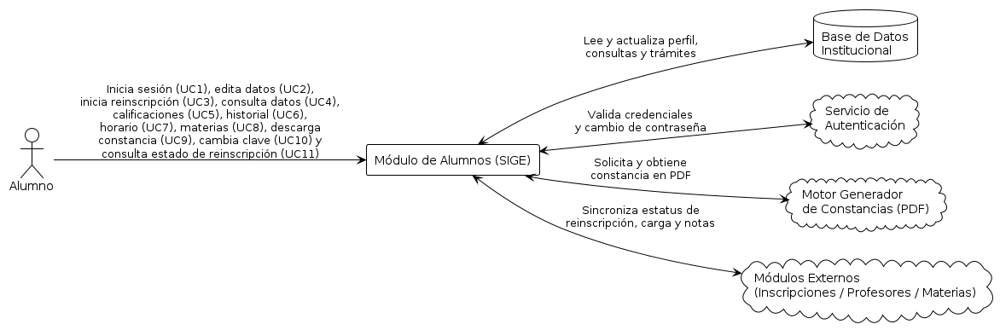
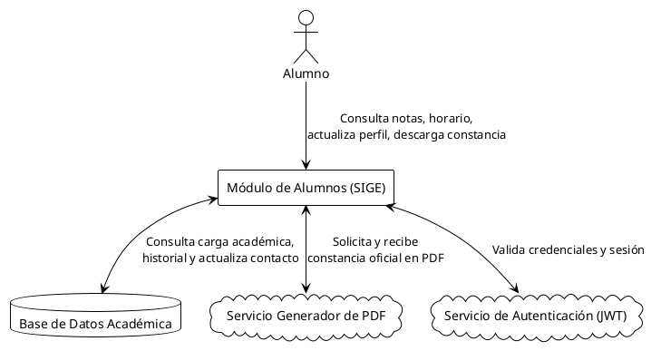

### 6.2. Diagrama de Casos de Uso

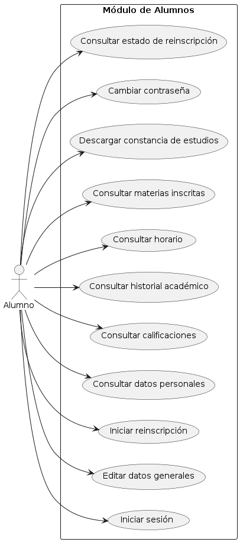
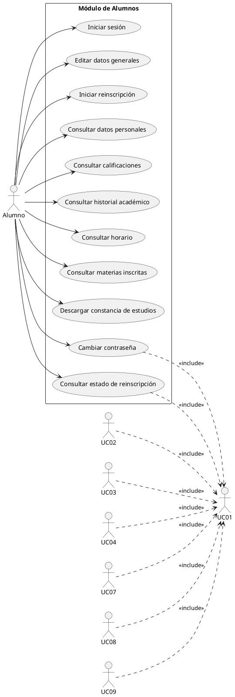

### 6.3. Diagrama de Clases

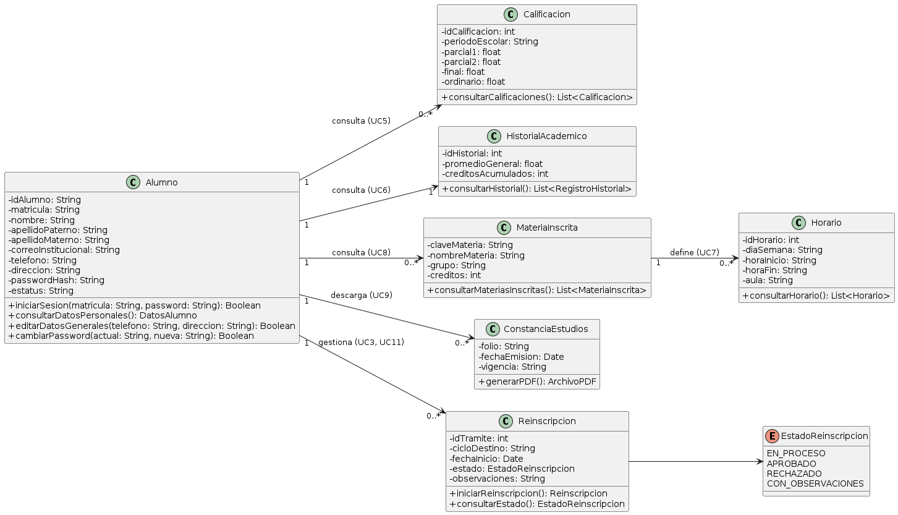
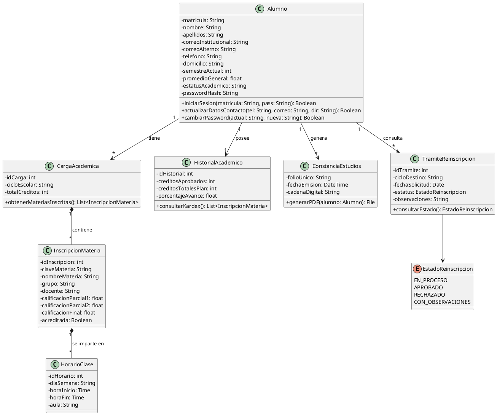
### 6.4. Diagrama de Componentes
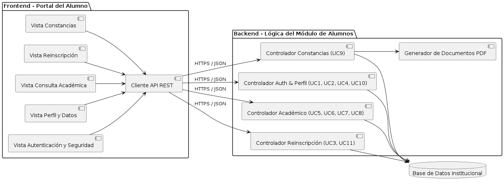

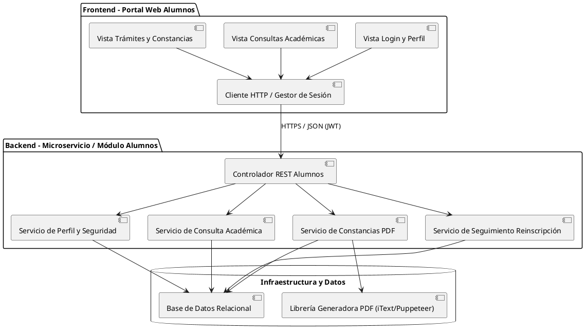
### 6.5. Diagramas de Secuencia

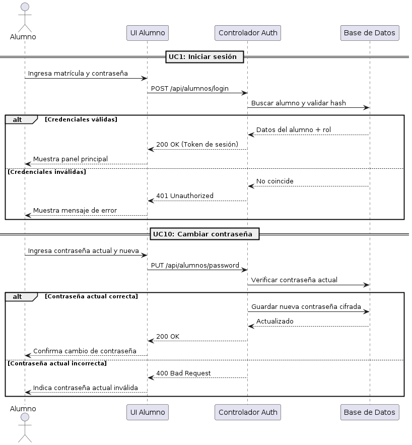
#### A. Secuencia: Descargar Constancia de Estudios (UC09)
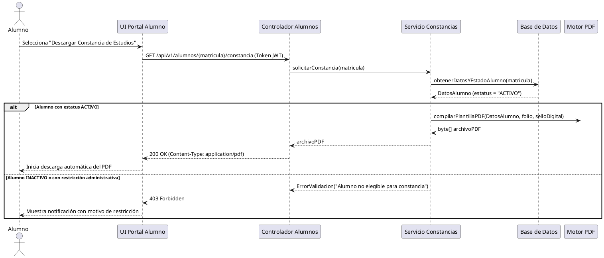
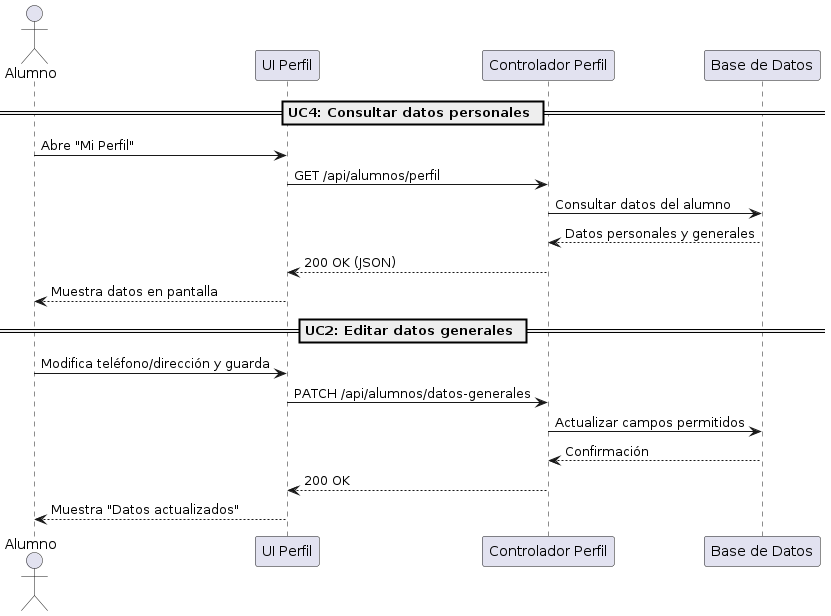
#### B. Secuencia: Cambiar Contraseña (UC10)

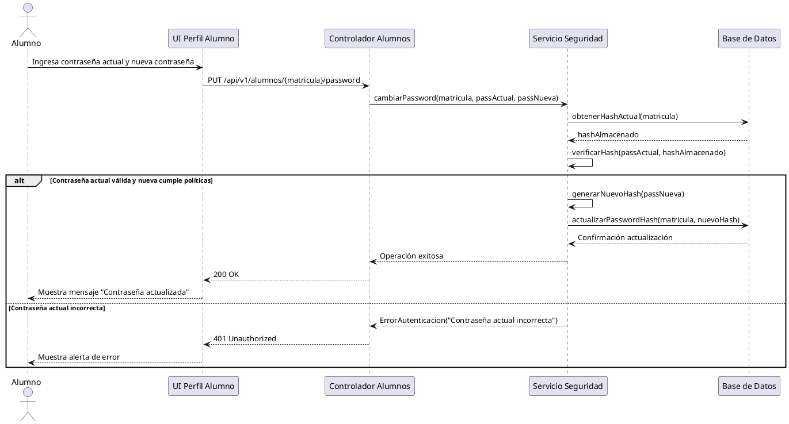
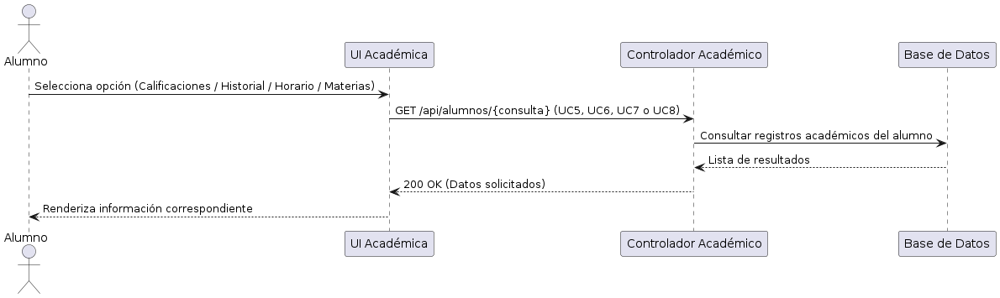
#### C. Diagrama de Secuencia C
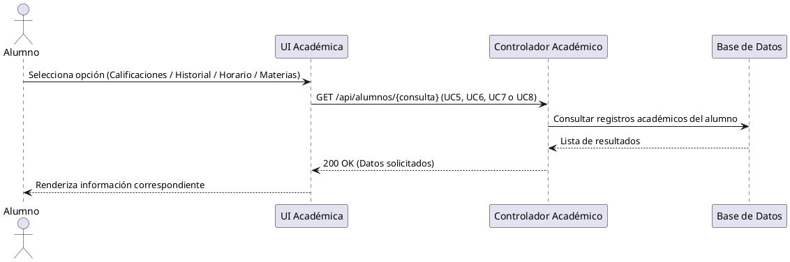

#### D. Diagrama de Secuencia D
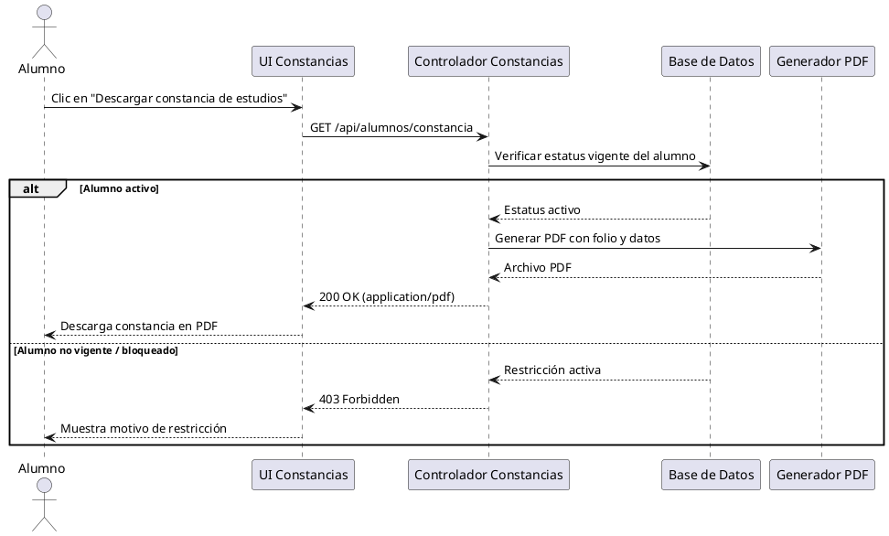
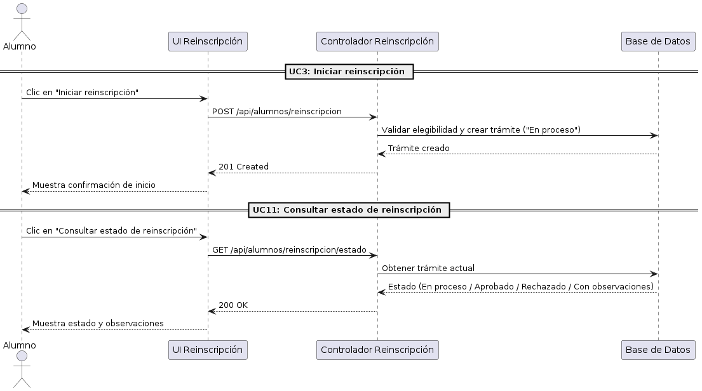
#### E. Diagrama de Secuencia E
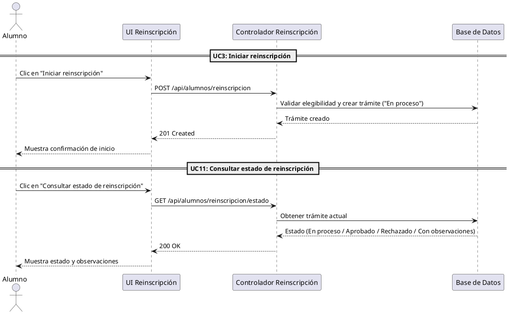
### 6.6. Diagrama de Estados (Trámite de Reinscripción - UC11)

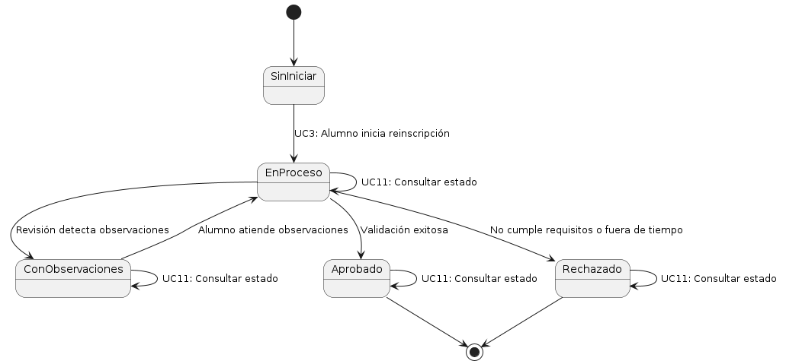

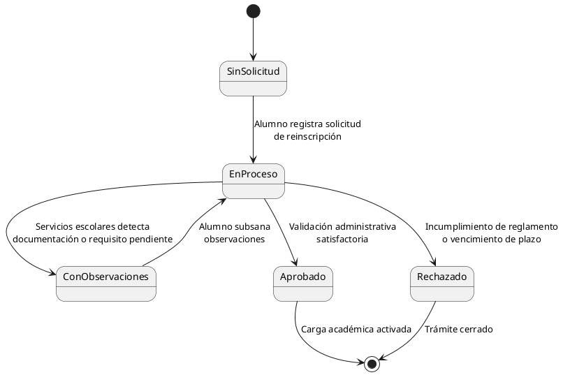
## VII. Interfaz de Usuario (Wireframes / Mockups)

El diseño visual del Módulo de Alumnos sigue principios de usabilidad centrados en el estudiante, priorizando la claridad, consistencia y accesibilidad. A continuación se presentan los wireframes de las principales pantallas del módulo:
1. **Pantalla de Inicio de Sesión:** Formulario minimalista con validación en tiempo real de matrícula institucional, campo de contraseña con opción de visibilidad y enlace de recuperación.
2. **Dashboard Principal del Alumno:**
   * **Barra lateral / Menú superior:** Acceso directo a *Inicio, Mi Perfil, Horario, Calificaciones, Historial Académico, Reinscripción* y *Constancias*.
   * **Tarjetas resumen (KPIs):** Promedio general acumulado, créditos aprobados vs. totales, semestre actual y estatus de reinscripción vigente.
3. **Vista de Horario Semanal:** Tabla matricial estructurada por días de la semana (Lunes a Sábado) y bloques horarios, diferenciando cada materia por color e indicando clave, grupo, aula y docente.
4. **Vista de Boleta e Historial:** Tabla filtrable por periodo escolar con desglose de evaluaciones parciales, calificación final y estado (*Acreditada / No acreditada*).
5. **Sección de Trámites y Descargas:** Indicador visual de progreso (*Stepper*) para el estado de reinscripción (`En proceso` → `Aprobado`) y botón de descarga directa en un clic para la constancia oficial en PDF.

## VIII. Autenticación, Autorización y Permisos del Módulo

El acceso al Módulo de Alumnos está protegido mediante autenticación basada en **JSON Web Tokens (JWT)** con expiración automática tras 15 minutos de inactividad (`RNF-03`).

### Matriz de Permisos del Módulo de Alumnos

| Funcionalidad / Recurso | Alumno (Propietario) | Otros Roles (Profesor / Coord. / Admin) |
| :--- | :---: | :---: |
| **Iniciar sesión y gestionar sesión propia** | Permitido | N/A (Usan sus respectivos módulos) |
| **Ver y editar datos de contacto propios** | Lectura / Escritura | Sin acceso directo en este módulo |
| **Cambiar contraseña propia** | Ejecución | Sin acceso |
| **Consultar calificaciones e historial** | Solo Lectura (Propios) | Sin acceso en esta vista |
| **Consultar horario y materias inscritas** | Solo Lectura (Propios) | Sin acceso en esta vista |
| **Consultar estado de reinscripción** | Solo Lectura (Propio) | Sin acceso en esta vista |
| **Descargar constancia de estudios (PDF)** | Ejecución (Propia) | Sin acceso en esta vista |

## IX. Glosario, Abreviaturas y Nomenclaturas

### Abreviaturas

* **API:** *Application Programming Interface* (Interfaz de Programación de Aplicaciones).
* **HTTPS:** *Hypertext Transfer Protocol Secure* (Protocolo Seguro de Transferencia de Hipertexto).
* **JSON:** *JavaScript Object Notation* (Notación de Objetos de JavaScript).
* **JWT:** *JSON Web Token* (Token Web JSON para autenticación).
* **KPI:** *Key Performance Indicator* (Indicador Clave de Rendimiento).
* **PDF:** *Portable Document Format* (Formato de Documento Portable).
* **RF:** Requerimiento Funcional.
* **RNF:** Requerimiento No Funcional.
* **SIGE:** Sistema Integral de Gestión Escolar.
* **UC:** *Use Case* (Caso de Uso).
* **UI:** *User Interface* (Interfaz de Usuario).
* **UML:** *Unified Modeling Language* (Lenguaje Unificado de Modelado).
* **UX:** *User Experience* (Experiencia de Usuario).

### Nomenclaturas

* **Requerimientos Funcionales:** `RF-XX` (ej. `RF-09` para Descargar constancia de estudios).
* **Requerimientos No Funcionales:** `RNF-XX` (ej. `RNF-03` para Sesiones expiradas).
* **Casos de Uso:** `UC-XX` (ej. `UC09` para Descargar constancia de estudios).
* **Rutas de Recursos Gráficos:** `resources/imgs/m1_[nombre_diagrama].png`.

## X. Referencias Bibliográficas
* Booch, G., Rumbaugh, J., & Jacobson, I. (2006). *El Lenguaje Unificado de Modelado: Guía del Usuario* (2.ª ed.). Addison-Wesley.
* Pressman, R. S., & Maxim, B. R. (2021). *Ingeniería del Software: Un enfoque práctico* (9.ª ed.). McGraw-Hill Education.
* Sommerville, I. (2011). *Ingeniería de Software* (9.ª ed.). Pearson Educación.
* Object Management Group (OMG). (2017). *OMG Unified Modeling Language (OMG UML), Version 2.5.1*. https://www.omg.org/spec/UML/
* PlantUML Documentation. (2025). *PlantUML Language Reference Guide*. https://plantuml.com/
